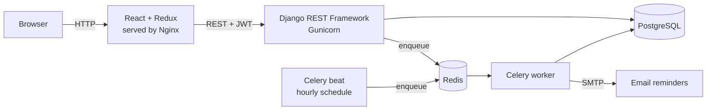
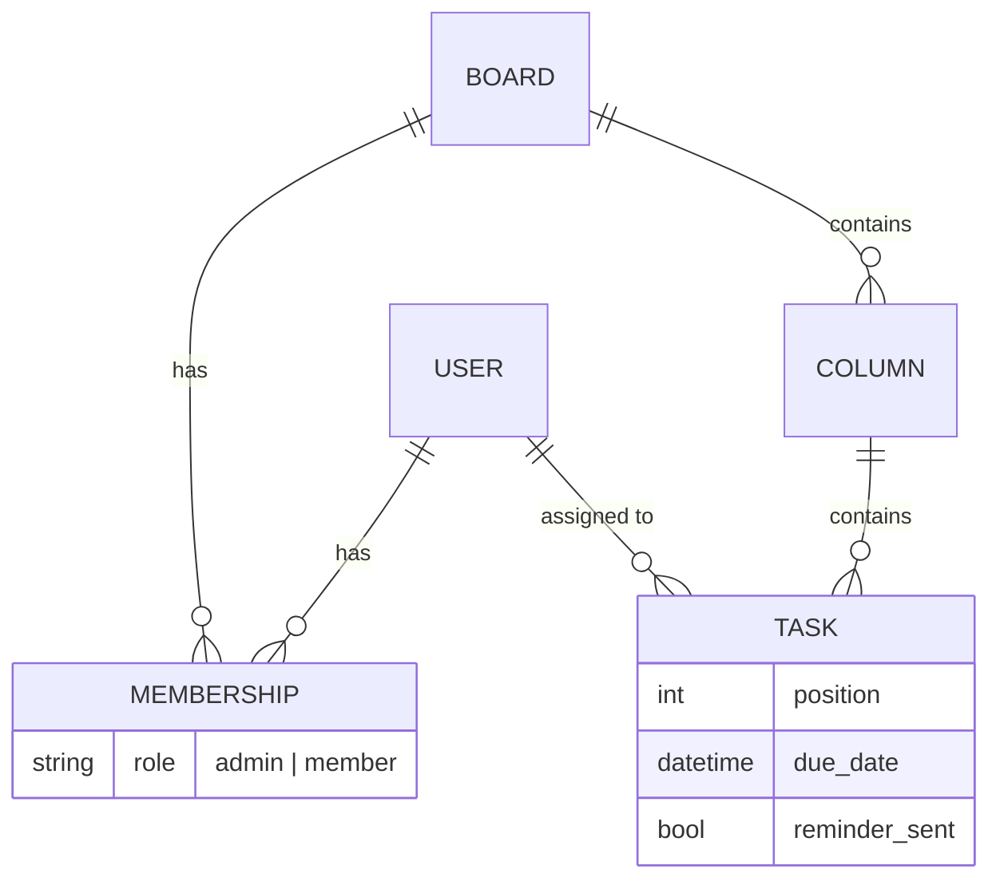

# TaskFlow — Team Project Management App

A Kanban-style task manager for small teams. Create boards, invite teammates with **admin** or **member** roles, drag tasks between columns, and get an **email reminder** before a task is due.


## Features

- **JWT authentication** — register, log in, and automatic access-token refresh in the React client (Axios interceptor).
- **Role-based access control** — every board has *admins* (manage board, columns and members) and *members* (create, edit and move tasks). Users only ever see boards they belong to.
- **Kanban boards** — new boards start with *To Do / In Progress / Done*; admins can add more columns.
- **Drag-and-drop** — built with `@hello-pangea/dnd`. The UI updates optimistically and the order is saved through a dedicated `move` endpoint that runs in a database transaction with row locks.
- **Background jobs** — a Celery task, scheduled hourly by Celery beat, emails assignees about tasks due in the next 24 hours (each task is reminded once).
- **Tests** — Pytest for the API (auth, permissions, ordering, reminders) and Vitest + React Testing Library for the frontend.
- **Containerized** — one `docker compose up` starts PostgreSQL, Redis, Django, Celery worker, Celery beat and the React app (served by Nginx).
- **CI** — GitHub Actions runs backend tests against PostgreSQL and frontend tests + build on every push and pull request.

## Architecture



**Data model**



## Getting started

### Option 1 — Docker (recommended)

```bash
git clone https://github.com/shaziadev/taskflow.git
cd taskflow
cp .env.example .env
docker compose up --build
```

- App: http://localhost:3000
- API: http://localhost:8000/api/
- Django admin: http://localhost:8000/admin/ (create a user with `docker compose exec backend python manage.py createsuperuser`)

Reminder emails are printed to the `celery-worker` logs by default (`docker compose logs -f celery-worker`). Set the SMTP variables in `.env` to send real emails.

### Option 2 — Run locally without Docker

**Backend** (uses SQLite if `DATABASE_URL` is not set):

```bash
cd backend
python -m venv venv && source venv/bin/activate
pip install -r requirements-dev.txt
python manage.py migrate
python manage.py runserver
```

Optional, for reminders (needs a local Redis):

```bash
celery -A config worker -l info
celery -A config beat -l info
```

**Frontend:**

```bash
cd frontend
cp .env.example .env      # VITE_API_URL=http://localhost:8000/api
npm install
npm run dev               # http://localhost:5173
```

## API reference

All endpoints except register/login/refresh need an `Authorization: Bearer <access token>` header.

| Method | Endpoint | Description | Who |
|---|---|---|---|
| POST | `/api/auth/register/` | Create an account | Public |
| POST | `/api/auth/login/` | Get `access` + `refresh` JWT tokens | Public |
| POST | `/api/auth/refresh/` | Get a new access token | Public |
| GET | `/api/auth/me/` | Current user | Logged in |
| GET / POST | `/api/boards/` | List my boards / create a board (creator becomes admin) | Logged in |
| GET | `/api/boards/{id}/` | Board with columns, tasks and members | Member |
| PATCH / DELETE | `/api/boards/{id}/` | Update / delete board | Admin |
| GET / POST | `/api/boards/{id}/members/` | List members / add member by username | Member / Admin |
| DELETE | `/api/boards/{id}/members/{user_id}/` | Remove a member | Admin |
| POST / PATCH / DELETE | `/api/columns/` `/api/columns/{id}/` | Manage columns | Admin |
| GET / POST | `/api/tasks/?board={id}` | List / create tasks | Member |
| PATCH / DELETE | `/api/tasks/{id}/` | Update / delete a task | Member |
| POST | `/api/tasks/{id}/move/` | Move a task: `{"column": 3, "position": 0}` | Member |

## Running tests

```bash
# Backend
cd backend && pytest -v

# Frontend
cd frontend && npm test
```

## Project structure

```
taskflow/
├── backend/
│   ├── config/           # settings, URLs, Celery app
│   ├── accounts/         # register / login (JWT) / me
│   ├── boards/
│   │   ├── models.py     # Board, Membership, Column, Task
│   │   ├── permissions.py# role-based access rules
│   │   ├── services.py   # create_board, move_task (ordering logic)
│   │   ├── tasks.py      # Celery reminder job
│   │   └── views.py      # DRF viewsets
│   └── tests/            # pytest suite
├── frontend/
│   └── src/
│       ├── api/          # Axios client with JWT refresh
│       ├── features/     # Redux Toolkit slices (auth, boards)
│       ├── pages/        # Login, Register, Boards, Board (drag-and-drop)
│       ├── components/
│       └── test/         # Vitest + React Testing Library
├── docker-compose.yml
└── .github/workflows/ci.yml
```

## Design decisions

- **Positions instead of linked lists** — each task stores an integer `position`. A move re-numbers only the affected columns inside one transaction, which keeps ordering simple and consistent.
- **Optimistic UI** — the board updates as soon as a card is dropped; if the API rejects the move the board is reloaded from the server.
- **Business logic in `services.py`** — views stay thin and the ordering logic is unit-tested directly.
- **Idempotent reminders** — the `reminder_sent` flag prevents duplicate emails if the job runs more than once.

## License

[MIT](LICENSE) © 2026 Shazia Abbas
